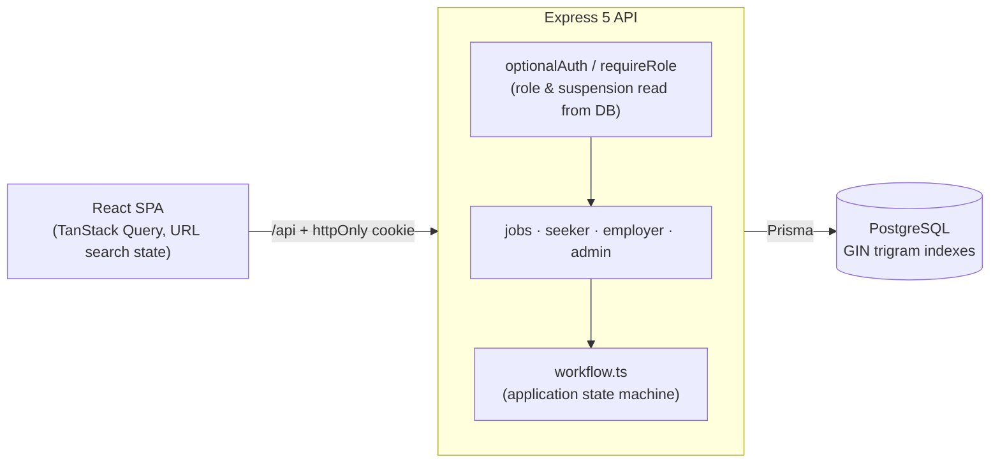
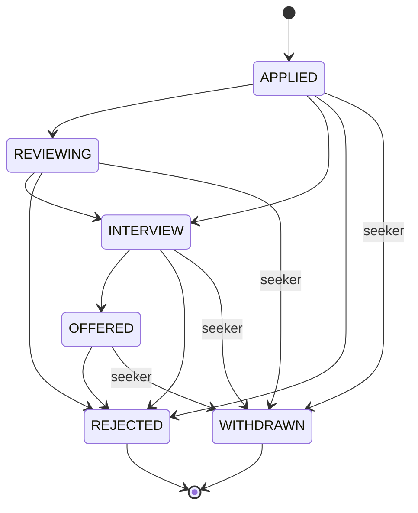

# 🧭 Hireloop — Job Board for Australia & New Zealand


A full-stack job portal with **three roles** — job seekers, employers and admins — built around how hiring actually works in AU/NZ: **work-rights screening**, **visa sponsorship filters**, state/region locations and salary ranges quoted the local way.

**Live demo:** _coming soon_

| Role | Email | Password |
|---|---|---|
| Job seeker | `seeker@example.com` | `Seeker1234!` |
| Employer | `employer@example.com` | `Employer1234!` |
| Admin | `admin@example.com` | `Admin1234!` |

Or use the one-click demo buttons on the login page.

<!-- Add screenshots to docs/ and uncomment:


-->

## Features

### Job seekers
- Search by keyword (title, description **or company**), country, state/region, category, work type, workplace (on-site / hybrid / remote), minimum salary and **visa sponsorship**
- Search state lives in the URL, so results are shareable and survive a refresh
- Apply with an optional cover letter; duplicate applications are blocked
- Track every application through a visual pipeline (Applied → Under review → Interview → Offered) and withdraw if plans change
- Save jobs for later
- Profile with headline, skills, résumé link and **right-to-work status** (citizen/PR, working holiday, student visa, requires sponsorship…)
- **Check my fit**: compares your profile and pasted résumé with a listing using Claude, and shows a score, matched and missing skills, strengths, gaps and cover-letter tips (see [AI job matching](#ai-job-matching))

### Employers
- Company profile shown on every listing
- Post, edit, close and reopen jobs, with validation (salary range, region must belong to country)
- Dashboard with applicant counts and an “awaiting review” indicator
- Review applicants with their skills, work rights and cover letter, and move them through an **enforced hiring workflow**

### Admins
- Platform stats (users by role, open/closed jobs, applications in the last 7 days)
- Search users and **suspend / reinstate** accounts — takes effect on the very next request
- Search and take down job listings

## Tech stack

| Layer | Tech |
|---|---|
| Frontend | React 18, TypeScript, Vite, React Router, TanStack Query |
| Backend | Node.js, Express 5, TypeScript, Zod validation |
| Database | PostgreSQL 16, Prisma ORM, `pg_trgm` trigram indexes |
| Testing | Vitest, Supertest (integration tests against a real Postgres), React Testing Library |
| DevOps | Docker (multi-stage), docker-compose, GitHub Actions CI |

## Architecture





## Design decisions

- **Role checks hit the database, not just the JWT.** The token only carries the user id; role and `suspended` are looked up on each request, so suspending an account takes effect immediately rather than when the token expires.
- **Hiring workflow as a state machine** (`server/src/lib/workflow.ts`). The API rejects invalid moves (e.g. Applied → Offered, or anything after Withdrawn) with `409`, and returns each applicant’s allowed `nextStatuses` so the UI only renders valid buttons.
- **Keyword search uses `pg_trgm` GIN indexes** on job title, description and company name, so `ILIKE '%term%'` queries keep using an index as the table grows, without the operational overhead of a separate search engine.
- **Ownership is part of every query** (`where: { id, companyId }`). Accessing another employer’s job or applicant returns `404`, not `403`, so IDs can’t be probed.
- **List endpoints omit large fields** (`omit: { description: true }`) and fetch “saved/applied” flags for the current page in two batched queries instead of N+1 lookups.
- **`/api/meta` is the single source of truth** for categories, regions and labels, so the client never drifts from server-side validation.
- **No admin self-registration** — the register schema is a discriminated union that only accepts `SEEKER` or `EMPLOYER`.

## AI job matching

`POST /api/seeker/jobs/:id/match` ([`server/src/lib/match.ts`](server/src/lib/match.ts), [`routes/seeker.ts`](server/src/routes/seeker.ts))

```
profile + listing ─┬─► eligibility rules in code ─────────────────────────────┐
                   └─► cache hit? ─yes──────────────────────────────────────►├─► response
                         │ no                                                 │
                         ▼                                                    │
                    within daily limits? ─no─► keyword match ───────────────►│
                         │ yes                                                │
                         ▼                                                    │
                    Claude (JSON schema) ─fails─► keyword match ────────────►│
                         │ ok: validate, clamp, cache                         │
                         └──────────────────────────────────────────────────►┘
```

- **Code decides the facts, the model decides the judgement calls.** Work rights against sponsorship, student and working-holiday visa limits, and on-site location are checked in code. The model never sees work rights or the sponsorship flag, so it can't reason about eligibility, and a listing can't argue its way past the rules.
- **Structured output, validated twice.** The request uses a JSON schema (`output_config.format`), and the response is parsed again with Zod. The score is clamped to 0–100, and lists are trimmed. A refusal, truncated output, invalid JSON, or the wrong shape all become a clean fallback, never a 500.
- **Prompt-injection aware.** Both the profile and the listing are user-written. They are passed as JSON inside tagged blocks, with an instruction to treat them only as data. The blast radius is small anyway: the result is advice shown to the seeker, and nothing acts on it.
- **Cost control.** Results are cached by a SHA-256 hash of the profile, the listing and the model. Asking again is free, and editing either side produces a fresh analysis. Simultaneous identical requests (a double click) share one API call. There are daily limits per seeker (`MATCH_USER_DAILY_LIMIT`, default 10) and for the whole site (`MATCH_SITE_DAILY_LIMIT`, default 200), with low effort, a 45 s timeout and one retry.
- **Always answers.** Without `ANTHROPIC_API_KEY`, over a limit, or when the API fails, the endpoint returns a keyword match that says why. Failed calls aren't cached or counted.
- **Privacy.** The pasted résumé is used for matching only and is excluded from what employers receive with an application.
- **Model:** `claude-opus-5-5` by default (`MATCH_MODEL`), with server-side refusal fallback (`fallbacks: "default"`).
- **The live demo runs without an API key** to stay free, so it shows keyword matching and says so next to the button. Set `ANTHROPIC_API_KEY` to turn on the AI analysis.

Tests use a fake analyzer and a fake SDK client, so CI never calls the API. They cover caching, cache invalidation on edit, concurrent requests, each fallback path, limits, roles, and every malformed-response case.

## Getting started

Prerequisites: Node.js 20+, Docker Desktop

```bash
npm install
npm run db:up                         # Postgres on localhost:5433
cp server/.env.example server/.env    # then set a real JWT_SECRET
npm run db:migrate -w server
npm run db:seed -w server             # demo accounts, 5 companies, 22 jobs
npm run dev                           # API on :4100, web on http://localhost:5174
```

## Testing

```bash
npm test          # server unit + integration, client component tests
npm run typecheck
```

The integration suite (`server/tests/integration`) covers role-based access, search filters and sorting, pagination, closed-job visibility, cross-company isolation, the full hiring workflow including invalid transitions, saved jobs, admin suspension/moderation, and AI job matching (caching, concurrency, limits and fallbacks).

## API overview

| Area | Endpoints |
|---|---|
| Auth | `POST /api/auth/register` · `POST /api/auth/login` · `POST /api/auth/logout` · `GET /api/auth/me` |
| Public | `GET /api/jobs` (filters: `q`, `country`, `region`, `category`, `workType`, `workplace`, `minSalary`, `sponsorship`, `sort`, `page`) · `GET /api/jobs/:id` · `GET /api/meta` |
| Seeker | `POST /api/jobs/:id/apply` · `PUT/DELETE /api/jobs/:id/save` · `GET/PUT /api/seeker/profile` · `POST /api/seeker/jobs/:id/match` · `GET /api/seeker/applications` · `POST /api/seeker/applications/:id/withdraw` · `GET /api/seeker/saved` |
| Employer | `GET/PUT /api/employer/company` · `GET/POST /api/employer/jobs` · `GET/PUT /api/employer/jobs/:id` · `PATCH /api/employer/jobs/:id/status` · `GET /api/employer/jobs/:id/applications` · `PATCH /api/employer/applications/:id` |
| Admin | `GET /api/admin/stats` · `GET /api/admin/users` · `PATCH /api/admin/users/:id` · `GET /api/admin/jobs` · `PATCH /api/admin/jobs/:id` |

## Deployment

One Docker image serves both the API and the built React app, and runs migrations on start-up.

1. Create a PostgreSQL database (e.g. [Neon](https://neon.tech) free tier). `pg_trgm` is available on Neon and most managed Postgres services.
2. On [Render](https://render.com), choose **New → Blueprint** and pick this repo; [`render.yaml`](render.yaml) sets up a free Docker web service and generates `JWT_SECRET`.
3. Set `DATABASE_URL`, `JWT_SECRET` (long random string) and `NODE_ENV=production`. Optionally set `ANTHROPIC_API_KEY` to turn on AI matching; without it, matching uses keywords.
4. Run `npx prisma db seed` once for the demo accounts.

## Roadmap

- Résumé upload to object storage (S3 / Cloudflare R2)
- Email notifications when an application status changes
- Saved searches with job alerts
- Employer analytics (views → applications conversion)

---

All companies, people and job listings in the seed data are fictional.
